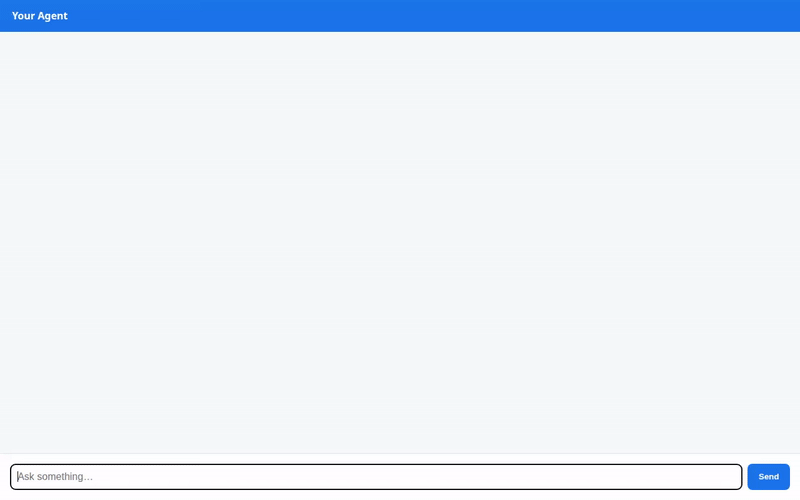

# Travel Concierge Agent

An intelligent, multi-modal travel assistant powered by the Google Agent Development Kit (ADK), Vertex AI Memory Bank, Firestore, Cloud Storage, and Gemini models.



---

## Overview

The **Travel Concierge Agent** helps users explore travel destinations, search curated trip packages, discover local attractions, generate visual showcase imagery and videos, convert currencies, and record long-term travel preferences across sessions.

---

## Features & Implemented Capabilities

- **Cross-Session Long-Term Memory**: Uses **Vertex AI Memory Bank** (`PreloadMemoryTool` & memory generation callback) to remember user preferences, budget limits, and favorite destinations across multiple chat sessions.
- **Destination Catalog & Search**: Queries and updates a **Google Cloud Firestore** database storing trip packages and custom user destinations.
- **Rich A2UI Display**: Renders interactive cards, lists, and media previews using **A2UI Schema Manager (v0.8 Basic Catalog)**.
- **Image Generation**: Generates customized travel showcase images using the **`gemini-3.1-flash-lite-image`** model in the Vertex AI `global` region.
- **Video Generation**: Generates short showcase videos using the **`gemini-omni-flash-preview`** model in the Vertex AI `global` region.
- **Cloud Media Storage**: Saves generated image and video artifacts to the Playground panel while streaming bytes directly to a public **Google Cloud Storage** bucket.
- **Location & Places Services**: Converts location queries into precise coordinates via the **Google Maps Geocoding API** and discovers surrounding attractions using the **Google Maps Places API (New)**.
- **Wikipedia Summaries**: Fetches real-world destination background and landmark summaries from Wikipedia.
- **Currency Conversion**: Converts travel budgets between world currencies.
- **Sandbox Code Execution**: Safely executes Python data analysis scripts using **`AgentEngineSandboxCodeExecutor`**.

---

## Google Cloud & Infrastructure Integration

| Service | Purpose |
|---|---|
| **Vertex AI Reasoning Engine** | Host deployment for ADK agent reasoning engine |
| **Vertex AI Memory Bank** | Managed long-term memory store for user profile and session history |
| **Google Cloud Firestore** | Database for destination packages and travel itineraries |
| **Google Cloud Storage** | Public media bucket for hosting generated showcase images and videos |
| **Google Maps Platform** | Geocoding API and Places API (New) for location discovery |
| **Cloud Run** | Host for the lightweight FastAPI chat UI proxy |

---

## Project Structure

```
.
├── app/
│   ├── agent.py               # Core ADK agent definition, tools, and callbacks
│   └── a2ui_utils.py          # A2UI response formatting utilities
├── frontend/
│   ├── main.py                # FastAPI proxy server for A2A communication
│   ├── static/index.html      # Responsive Chat UI with built-in A2UI card renderer
│   └── requirements.txt       # Frontend dependencies
├── agents-cli-manifest.yaml   # Agent Engine deployment manifest
├── requirements.txt           # Agent runtime dependencies
└── demo.gif                   # Recorded agent demo preview
```

---

## Local Development & Setup

### Prerequisites

- Python 3.11+
- Google Cloud CLI (`gcloud`) authenticated to your GCP project
- Firestore database initialized in Native mode

### 1. Environment Configuration

Set the required GCP environment variables:

```bash
export GCP_PROJECT="<YOUR_GCP_PROJECT_ID>"
export GCP_LOCATION="us-central1"
export GOOGLE_MAPS_API_KEY="<YOUR_MAPS_API_KEY>"
```

### 2. Install Agent Dependencies

```bash
pip install -r requirements.txt
```

### 3. Run Agent Playground Locally

Start the interactive ADK Agent Web UI:

```bash
adk web app
```

### 4. Run Frontend Proxy Locally

Navigate to the `frontend` directory, install dependencies, and run the FastAPI server:

```bash
cd frontend
pip install -r requirements.txt
export AGENT_ENGINE_RESOURCE_NAME="projects/<PROJECT_ID>/locations/<LOCATION>/reasoningEngines/<ENGINE_ID>"
export AGENT_DIRECTORY="app"
python main.py
```

Open your browser to the local port configured by the server (default `8080`) to interact with the full chat interface.
